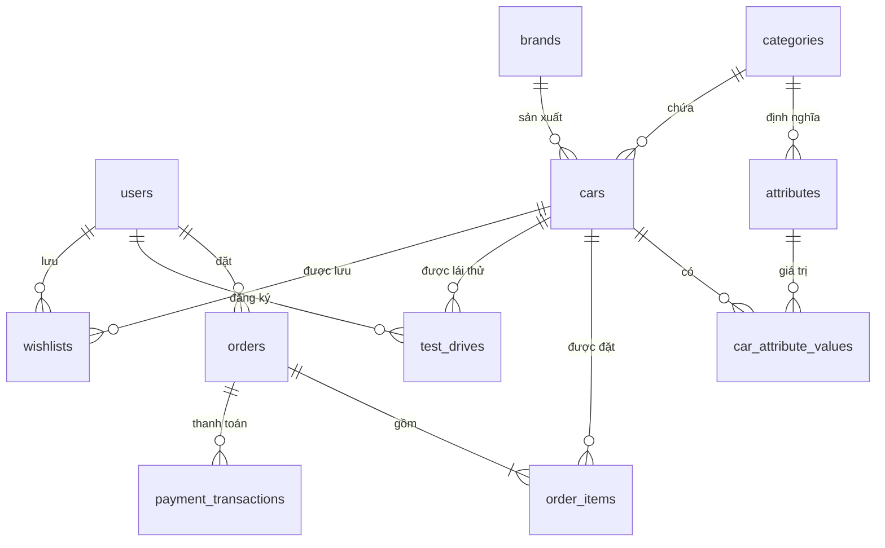

# ĐỀ TÀI: XÂY DỰNG WEBSITE BÁN Ô TÔ AUTOSHOP – QUẢN LÝ DỮ LIỆU XE THEO THÔNG SỐ ĐỘNG VÀ ĐẶT CỌC TRỰC TUYẾN

Môn: Lập trình mã nguồn mở · Công nghệ: PHP 8.3, Laravel 13, MySQL 8, Blade · Môi trường: Laragon (Windows)

---

## 1. Giới thiệu chung

### 1.1. Lý do chọn đề tài
Thị trường ô tô Việt Nam tăng trưởng nhanh, khách hàng ngày càng tìm hiểu và so sánh xe trên mạng trước khi
đến showroom. Khác với hàng tiêu dùng thông thường, ô tô có **giá trị rất lớn**, **mỗi dòng xe có bộ thông số
khác nhau** (sedan quan tâm mức tiêu hao, SUV quan tâm số chỗ/dẫn động, xe điện quan tâm dung lượng pin và
quãng đường) và **người mua thường đặt cọc trước** rồi mới làm thủ tục, nhận xe. Đề tài giải quyết ba bài toán:

1. Trưng bày, tìm kiếm, lọc và so sánh xe theo đúng thông số của từng dòng xe.
2. Đặt mua và **đặt cọc trực tuyến an toàn** (không bán trùng xe, không ghi nhận tiền hai lần).
3. Quản lý dữ liệu xe đầy đủ, nhất quán (PIM) cho người bán.

### 1.2. Mục tiêu
- **Thương mại điện tử:** danh sách xe, bộ lọc động, chi tiết xe, so sánh, yêu thích, giỏ xe, đặt mua, tài khoản.
- **Nghiệp vụ đặc thù ô tô:** tính chi phí lăn bánh ước tính, tiền cọc theo %, đăng ký lái thử, công cụ tính trả góp,
  phân biệt xe mới / xe đã qua sử dụng (số km).
- **PIM:** thông số động theo dòng xe (EAV), chỉ số hoàn thiện dữ liệu, quy trình duyệt, nhập/xuất CSV.
- **Thanh toán:** đặt cọc VNPay (HMAC‑SHA512, IPN, idempotent) + cổng giả lập; đặt cọc tại showroom.
- Cài đặt được bằng một file `setup.bat` trên Laragon, có dữ liệu mẫu, giao diện tiếng Việt, sáng/tối.

### 1.3. Đối tượng và phạm vi
Khách vãng lai, khách hàng có tài khoản, quản trị viên (nhân viên showroom), cổng VNPay. Phạm vi gồm 11 bảng
nghiệp vụ. Chưa làm: hợp đồng điện tử, tích hợp ngân hàng xét duyệt trả góp, đa chi nhánh tồn kho riêng,
gửi email/SMS, hoàn tiền tự động.

### 1.4. Công cụ

| Thành phần | Công nghệ | Vai trò |
|---|---|---|
| Ngôn ngữ | PHP 8.3 | Xử lý phía máy chủ |
| Framework | Laravel 13 | MVC, Eloquent, migration, validation, scheduler |
| CSDL | MySQL 8.4 (InnoDB) | Transaction, khóa dòng, khóa ngoại |
| Giao diện | Blade + CSS/JS tự viết | Không cần build Node; hình xe vẽ bằng SVG theo màu |
| Thanh toán | VNPay 2.1.0 | Đặt cọc online + cổng giả lập |
| Kiểm thử | PHPUnit (SQLite in‑memory) | 15 kịch bản tự động |
| Môi trường | Laragon | Apache, PHP, MySQL, Composer, HeidiSQL |

### 1.5. Cơ sở lý thuyết
- **MVC + Service:** Controller gọn, nghiệp vụ tiền/kho nằm trong `CartService`, `OrderService`, `PaymentService`.
- **EAV (Entity–Attribute–Value):** bảng `attributes` định nghĩa thông số theo dòng xe, `car_attribute_values`
  lưu giá trị. Thêm dòng xe "MPV" hay thông số "Số túi khí" chỉ là thêm dữ liệu, không sửa bảng.
- **Transaction + khóa dòng (`SELECT … FOR UPDATE`):** hai khách cùng đặt chiếc xe cuối cùng → chỉ một người thành công.
- **HMAC‑SHA512 + idempotent:** kiểm tra chữ ký dữ liệu VNPay gửi về; IPN gửi lặp chỉ ghi nhận một lần.

---

## 2. Phân tích yêu cầu

### 2.1. Tác nhân – chức năng

| Tác nhân | Chức năng |
|---|---|
| Khách vãng lai | Xem/tìm/lọc/so sánh xe, tính trả góp, đăng ký lái thử, giỏ xe, đặt mua & đặt cọc, đăng ký/đăng nhập |
| Khách hàng | + Lịch sử đơn, tự hủy đơn chưa cọc, xem lịch lái thử, danh sách yêu thích |
| Quản trị viên | Dashboard; quản lý xe (PIM), dòng xe, hãng, thông số; xử lý đơn; quản lý lịch lái thử; nhập/xuất CSV |
| Cổng VNPay | Gửi kết quả thanh toán qua IPN |

### 2.2. Yêu cầu chức năng chính

| Phân hệ | Yêu cầu |
|---|---|
| Cửa hàng | Lọc theo hãng, khoảng giá, mới/cũ, đời xe, thông số động; sắp xếp; phân trang giữ bộ lọc |
| Chi tiết xe | Bảng thông số theo dòng xe; tính trả góp (lãi suất, kỳ hạn, % vay); form lái thử; xe tương tự |
| Giỏ xe | Tối đa 3 chiếc/mẫu; không vượt số xe tại đại lý; giá luôn tính lại từ CSDL |
| Đặt mua | Thông tin người đứng tên (CCCD), showroom nhận xe; phí lăn bánh; cọc 10% (tối thiểu 10 triệu) |
| Thanh toán | VNPay/giả lập; ghi nhận một lần; đơn VNPay chưa cọc tự hủy sau 15 phút, trả xe về kho |
| Đơn hàng | pending → confirmed → delivering → completed; hủy được ở các bước chưa bàn giao; hủy = hoàn kho |
| Lái thử | Chọn ngày (≤ 60 ngày), khung giờ, showroom; chống đăng ký trùng; admin xác nhận |
| PIM | Thông số động, % hoàn thiện, Nháp → Chờ duyệt → Đang bán, chặn xuất bản khi thiếu thông số bắt buộc, CSV |

### 2.3. Yêu cầu phi chức năng
Mật khẩu bcrypt, chỉ ký tự ASCII; CSRF mọi form (trừ IPN); middleware `admin`; throttle đăng nhập/đặt hàng/lái thử;
tiền lưu số nguyên VND; xóa mềm xe; snapshot giá trong đơn; giao diện tiếng Việt, responsive, sáng/tối.

---

## 3. Thiết kế cơ sở dữ liệu

### 3.1. Sơ đồ ERD (Mermaid)



### 3.2. Mô tả bảng

| Bảng | Vai trò | Cột / ràng buộc chính |
|---|---|---|
| users | Tài khoản | role (customer/admin), phone, email unique |
| categories | Dòng xe | name, slug unique, sort_order |
| brands | Hãng xe | name, slug unique, country |
| attributes | Thông số theo dòng xe | category_id, code, type (text/number/select), unit, options JSON, is_required, is_filterable; unique(category_id, code) |
| cars | Xe | sku unique, slug unique, year, condition (new/used), mileage, color, color_hex, price, sale_price, stock, status, completeness, is_featured; soft delete |
| car_attribute_values | Giá trị thông số | car_id, attribute_id, value; unique(car_id, attribute_id) |
| orders | Đơn đặt xe | code unique, CCCD, showroom, subtotal, registration_fee, total, deposit_amount, payment_method, payment_status, status |
| order_items | Dòng đơn (snapshot) | name, sku, color, year, price, quantity; car_id nullOnDelete |
| payment_transactions | Giao dịch | gateway, transaction_code unique, amount, status, gateway_transaction_no, raw_response JSON, paid_at |
| test_drives | Lịch lái thử | car_id, user_id, showroom, preferred_date, preferred_time, status |
| wishlists | Xe yêu thích | unique(user_id, car_id) |

### 3.3. Thông số theo dòng xe (dữ liệu mẫu)

| Dòng xe | Thông số (★ bắt buộc, ⧩ dùng để lọc) |
|---|---|
| Sedan | Nhiên liệu ★⧩, Hộp số ★⧩, Động cơ ★, Công suất, Mức tiêu hao |
| SUV / Crossover | Số chỗ ★⧩, Nhiên liệu ★⧩, Hộp số ★, Hệ dẫn động ★⧩, Động cơ ★, Công suất |
| Bán tải | Nhiên liệu ★, Hộp số ★⧩, Hệ dẫn động ★⧩, Động cơ ★, Tải trọng thùng |
| Hatchback | Nhiên liệu ★, Hộp số ★⧩, Động cơ ★, Số túi khí ⧩ |
| Xe điện | Số chỗ ★⧩, Dung lượng pin ★, Quãng đường/lần sạc ★⧩, Sạc nhanh, Công suất |

---

## 4. Luồng nghiệp vụ

### 4.1. Đặt mua xe an toàn
```
Giỏ xe (session: car_id => SL) → CartService::summary() tính lại giá từ CSDL
→ DB::transaction {
     tạo orders (subtotal, registration_fee, total, deposit_amount)
     với mỗi xe: Car::lockForUpdate() → kiểm tra stock → decrement → order_items (snapshot)
     tạo payment_transactions (pending, amount = tiền cọc)
  } (lỗi bất kỳ → rollback toàn bộ)
→ VNPay: chuyển sang cổng (thật hoặc giả lập)   |   Showroom: trang kết quả, nhân viên gọi hẹn cọc
```

### 4.2. Công thức tiền
- Chi phí lăn bánh ước tính = (giá × 10% với xe mới hoặc 2% với xe cũ + 20.000.000đ phí biển số/đăng kiểm/bảo hiểm) × số lượng
- Tiền cọc = max(10.000.000đ, 10% × tổng lăn bánh), làm tròn nghìn đồng
- Trả góp hằng tháng = P·r / (1 − (1+r)^−n), P = giá × % vay, r = lãi năm / 12

### 4.3. Máy trạng thái đơn
```
pending ──► confirmed ──► delivering ──► completed
   │            │              │
   └────────────┴──────────────┴──► cancelled  (hoàn xe về kho)
```
Thanh toán: `unpaid → deposited` (VNPay thành công) `→ paid` (khi bàn giao xe); `failed` khi thanh toán lỗi.

### 4.4. VNPay & IPN

| RspCode | Điều kiện |
|---|---|
| 00 | Chữ ký đúng, đúng số tiền, xử lý lần đầu → đơn `confirmed` + `deposited` |
| 02 | Giao dịch đã xử lý trước đó → bỏ qua |
| 04 | Sai số tiền |
| 01 | Không tìm thấy giao dịch |
| 97 | Sai chữ ký |

---

## 5. Kiểm thử tự động (`php artisan test`)

| # | Kịch bản | Kết quả mong đợi |
|---|---|---|
| 1 | Mở các trang công khai | HTTP 200 |
| 2 | Lọc SUV theo “7 chỗ” | Chỉ hiện xe 7 chỗ |
| 3 | Phân trang giữ bộ lọc | Link trang có `condition=new` |
| 4 | Thêm 2 xe khi kho còn 1 | Từ chối |
| 5 | Đặt 2 xe rồi tự hủy | Kho giảm 2 rồi hoàn lại |
| 6 | VNPay giả lập thành công | `confirmed` + `deposited` |
| 7 | IPN sai chữ ký / sai tiền / hợp lệ / gửi lặp | 97 / 04 / 00 / 02 |
| 8 | Đơn VNPay quá 15 phút | Bị hủy, hoàn kho; đơn đã cọc không bị hủy |
| 9 | Khách vào /admin | Chưa đăng nhập → 302; khách → 403 |
| 10 | Admin mở 10 trang quản trị | HTTP 200 |
| 11 | Xuất bản xe thiếu thông số bắt buộc | Bị chặn, không tạo bản ghi |
| 12 | Nhảy cóc trạng thái đơn | Bị chặn; đi đúng bước thì thành công |
| 13 | Nhập CSV 4 dòng (2 lỗi) | Chỉ nhập 2 dòng hợp lệ |
| 14 | Đăng ký mật khẩu có dấu | Từ chối |
| 15 | Đăng ký lái thử | Tạo lịch trạng thái “Mới” |

## 6. Hướng phát triển
Ảnh thật nhiều góc / 360°, đa chi nhánh tồn kho, hợp đồng điện tử, tích hợp ngân hàng duyệt vay, MoMo/ZaloPay,
email/SMS nhắc lịch lái thử, đánh giá xe, mã khuyến mãi, phân quyền nhân viên (RBAC).
